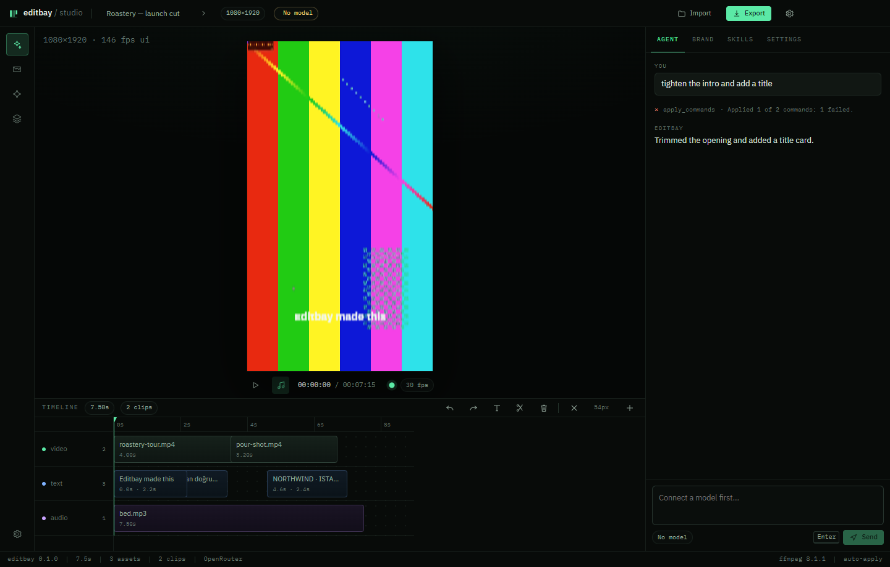

# Editbay

**The AI cutting room for brands.** A local-first, open-source video studio where a coding agent edits your timeline — and learns how your brand looks, sounds and sells.

> Status: **v0.1 preview**. The editing core, FFmpeg renderer and agent harness work end to end. Expect rough edges; the roadmap is in [docs/roadmap.md](docs/roadmap.md).



## Why another editor

Video editors are built for people who already know video editing. AI video tools generate generic clips that ignore the brand. Editbay takes the opposite bet: the model never touches pixels directly. It writes **validated commands** against a real timeline, so:

- the editor keeps working when the model is wrong (every change is undoable);
- the same command set powers the UI, the agent, CLI and tests;
- the "AI" is a senior editor that remembers the client — logo rules, tone, colours, captions, platform specs.

Think of it as the Cursor of video editors: a workspace where the agent and the human share one project, one history and one set of skills.

## What works today

- **Desktop app** (Windows, Linux, macOS) built with Electron + React.
- Import video / audio / images, timeline with trim, reorder, split, text overlays, music bed.
- Real **FFmpeg export** (H.264/AAC, 1080×1920 default), with progress and honest preview/export differences.
- **Agent panel**: describe the edit, the agent reads the project, applies commands, shows what changed. OpenRouter OAuth, your own API key, or a local model (LM Studio / Ollama).
- **Brand memory**: `brands/<id>/identity.md` plus dated memory notes, all human-readable markdown.
- **Skills**: `SKILL.md` playbooks the agent loads when the request matches — built-in ones for rough cuts, captions, end cards, colour looks, delivery specs and effect authoring.
- **Effect system**: parametric effects with one definition shared by preview (canvas) and export (FFmpeg filters). The agent can author new effects as code.

## Architecture

```
apps/desktop        Electron shell + React UI (main / preload / renderer)
packages/core       Project model, command engine, undo, change summaries (pure TS)
packages/engine     FFprobe, FFmpeg filter graphs, export, thumbnails
packages/harness    Providers, agent loop, tools, skills, memory, receipts
packages/effects    Effect + transition catalog (preview style + ffmpeg mapping)
packages/ui         Design system (black/green cockpit, IBM Plex)
archive/kmp-prototype  The earlier Kotlin Multiplatform research prototype (kept for reference)
```

**Platform plan:** desktop first. The same React UI is designed to be wrapped for Android then iOS (Capacitor shell + native media plugins); the core, engine contracts and harness are platform-agnostic. See [docs/platforms.md](docs/platforms.md).

## Quick start

Requirements: Node 20.19+, pnpm 10, FFmpeg 6+ on `PATH` (or set `EDITBAY_FFMPEG`).

```bash
pnpm install
pnpm dev          # app with hot reload
pnpm build        # production bundles in apps/desktop/out
pnpm test         # vitest across packages
pnpm typecheck
```

Exports land where you choose in the save dialog. Project autosaves to the app workspace (`…/Editbay/workspace/projects/current.json`); the workspace root is shown in Settings.

## Privacy

- Media never leaves the machine. Only the prompt, asset **labels**, timeline summary, brand identity and enabled skills go to the model you configure.
- API keys live in the OS keychain (Electron `safeStorage`), never in project files or logs.
- No account, no telemetry, no server. BYOK or a local model.

## Licence

Apache-2.0. FFmpeg is invoked as a separate binary; distribution builds must ship an LGPL build and its source notice (see [docs/licensing.md](docs/licensing.md)).
